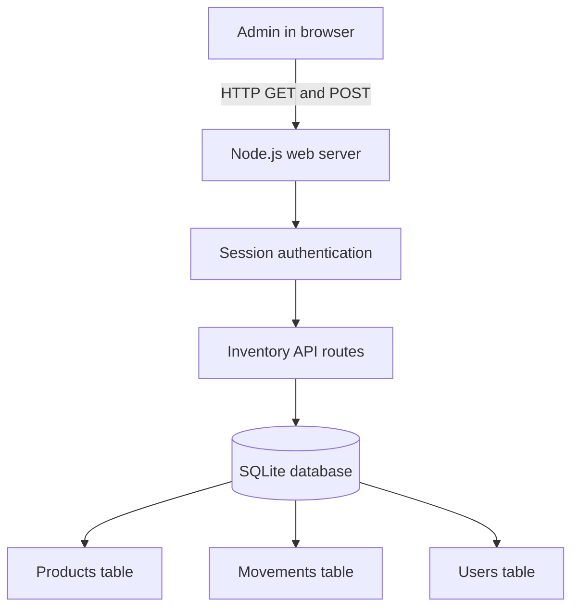
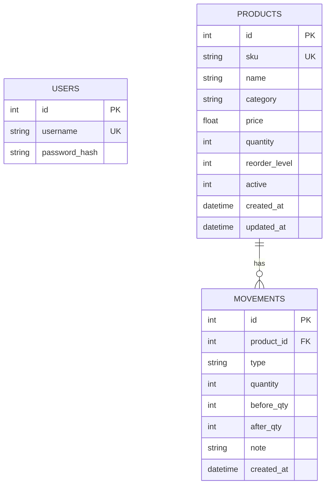
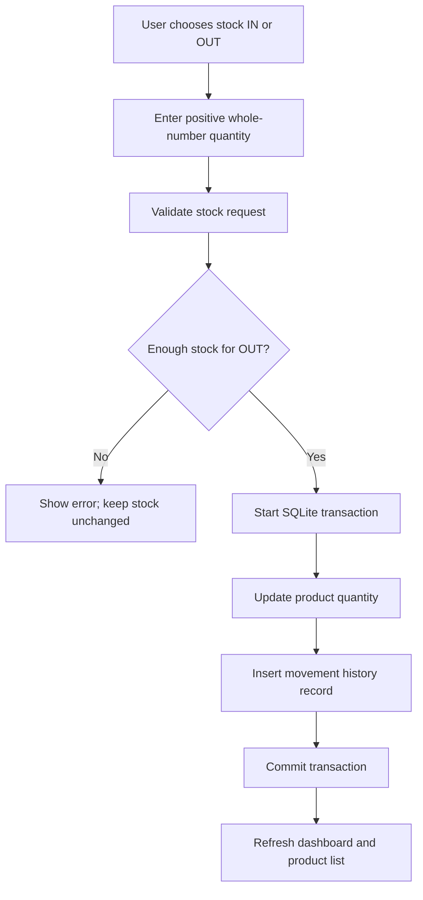

# System Design — Inventory Management System

## 1. Architecture

- **Client:** browser-based JavaScript application with dashboard, forms and product tables.
- **Server:** Node HTTP server handles sessions, validation, CRUD and reports.
- **Database:** SQLite stores three related entities persistently on disk.

## 2. Entity relationship diagram

## 3. Inventory update flow

## 4. Use cases

**Actor:** Admin

| Use case | Result |
|---|---|
| Authenticate | Log in or log out |
| Manage products | Create, view, update, archive |
| Search and filter | Find products and low-stock items |
| Maintain inventory | Add or withdraw stock |
| Review movements | View audit trail of recorded changes |
| View dashboard | See totals and stock alerts |
| Export report | Download current product inventory CSV |

## 5. Important design decisions

- **Unique SKU** avoids duplicate product codes.
- **Soft delete** preserves historical stock records even when a product is archived.
- **SQLite transaction** keeps a stock change and movement record together.
- **Quantity cannot be negative**, enforced by server validation and database constraints.
- **Passwords are salted and hashed** with Node.js `scrypt`, never stored in clear text.
- **In-memory sessions** are sufficient only for the local college demo; a production deployment requires stronger session infrastructure.
